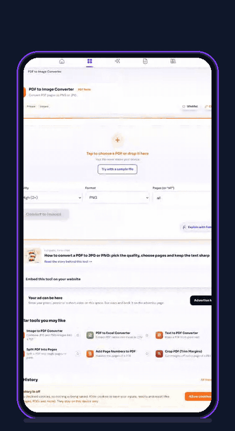
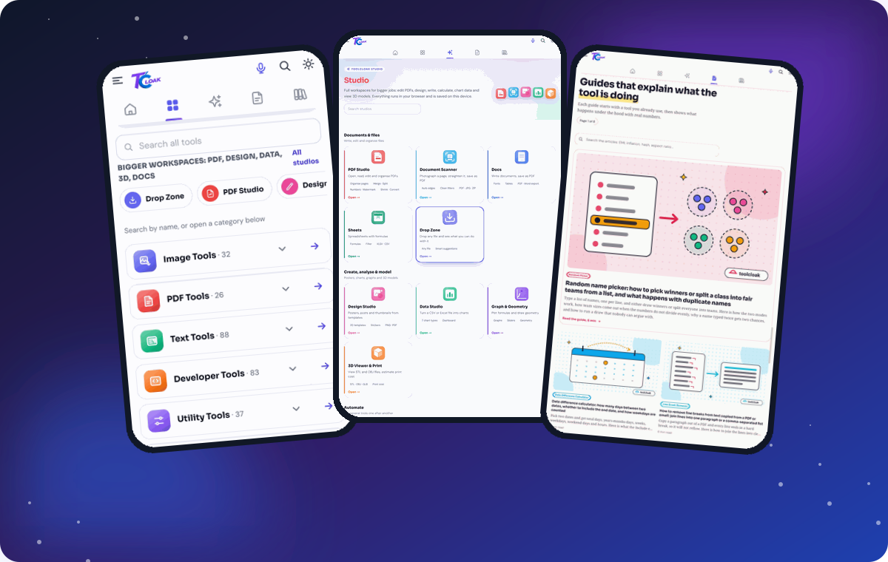
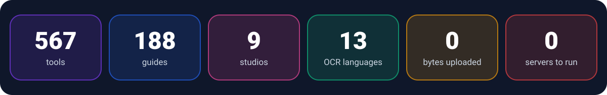
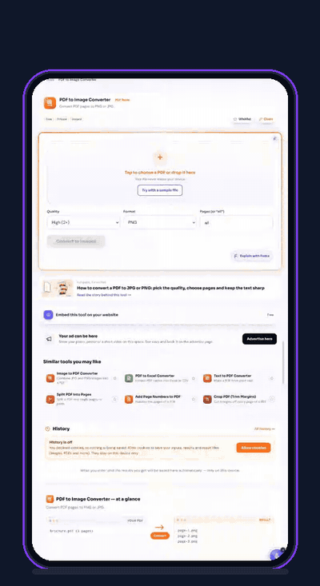
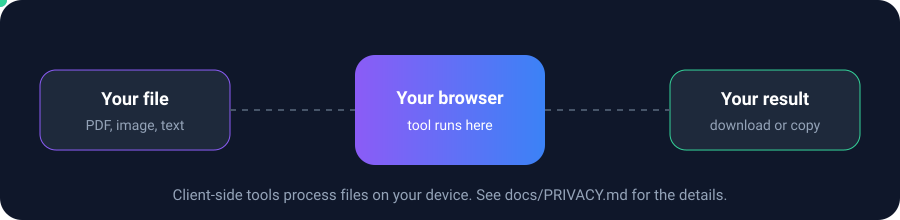
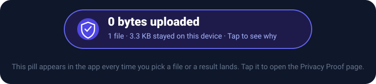
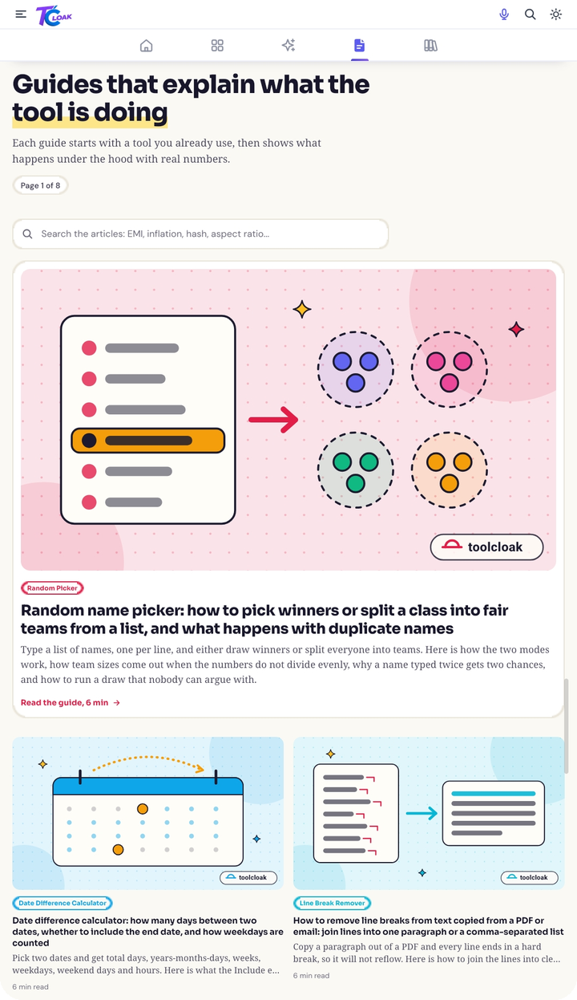
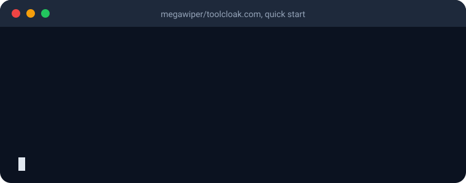

<div align="center">


<br/>

[](https://toolcloak.com)
[](docs/TOOLS.md)
[](docs/GUIDES.md)
[](docs/PRIVACY.md)

[](docs/TECH_STACK.md)
[](docs/TECH_STACK.md)
[](docs/TECH_STACK.md)
[](docs/DEPLOYMENT.md)
[](docs/DEPLOYMENT.md)
[](docs/PWA_AND_OFFLINE.md)


### Pick a tool. Use it. Your file never goes anywhere.

**Compress a PDF, shrink a photo to 50 KB, format JSON, plan your SIP, scan a page, chart a CSV, ask Fedra to do it for you.**
**All of it runs in your browser. No account. No upload. No ad wall.**

<br/>

<a href="docs/MEDIA.md"></a>

<sub><b>Real recording from a phone.</b> PDF to images, converted on the device. Look at the pill: <b>0 bytes uploaded</b>.</sub>

<br/><br/>



<br/>

<a href="https://toolcloak.com"></a>

<br/><br/>



</div>

<br/>

## Contents

[What is Toolcloak?](#what-is-toolcloak) · [See it in action](#see-it-in-action) · [Why it is different](#why-it-is-different) · [567 tools](#567-tools-in-17-categories) · [Studios](#studios) · [Tool Chains](#tool-chains) · [Fedra](#fedra-the-assistant-with-no-ai-server) · [Privacy proof](#privacy-you-can-check) · [Security](#security) · [My Space and Sync](#my-space-and-device-sync) · [Voice](#voice-and-automation) · [Guides](#188-guides-that-explain-the-tool) · [Embed](#embed-any-tool) · [Everything else](#everything-else-in-the-box) · [Architecture](#architecture) · [Tech stack](#tech-stack) · [Quick start](#quick-start) · [Deploy](#deploy) · [Docs](#documentation) · [Contributing](#contributing)


## What is Toolcloak?

Toolcloak is a free website of browser-based tools at **[toolcloak.com](https://toolcloak.com)**, built as a fast, private alternative to the usual "upload your file to a stranger's server" tool sites.

You open a tool, drop in a file or some text, and the work happens **on your device**. There is no sign-up, the site is a **static export** hosted on Cloudflare Pages, and there is **no server code of ours** that could receive your files.

It started as a handful of utilities and grew into a small platform: **567 tools in 17 categories**, **nine Studios** for bigger jobs, **Tool Chains** that link tools into one flow, an on-device assistant called **Fedra**, **188 long-form guides**, an installable offline app, and a live counter that shows how many bytes of your files have been uploaded: **0**.


## See it in action

<div align="center">



<sub>Filmed on a phone, no editing tricks to hide anything. <a href="assets/media/demo-full.mp4">Watch the sharper MP4</a>.</sub>

</div>

| Step | What happens |
|---|---|
| 1 | Open any PDF tool. Every tool page has the same layout and the same *Free, Private, Instant* tags. |
| 2 | Pick a PDF. The file never leaves your device. |
| 3 | Choose quality (Normal 1x, High 2x, Very high 3x) and format (PNG or JPG). |
| 4 | Convert. It says *Processing on your device*. |
| 5 | Every page is an image, with **Download all**, per-page **Download**, **Send to**, **Open in Design Studio** and **Save to Artifacts**. |
| 6 | The pill says **0 bytes uploaded**. Tap it to see why. |
| 7 | Name the file and save it. |


## Why it is different

| | |
|---|---|
| 🔒 **Private by construction** | Static site, no backend of ours, libraries bundled with the site instead of loaded from outside CDNs. |
| 🧾 **Proof, not a slogan** | A "0 bytes uploaded" pill watches every `fetch`, `XMLHttpRequest` and `sendBeacon` and adds up file-like bodies. [See how](#privacy-you-can-check). |
| 🧠 **An assistant with no AI server** | Fedra plans multi-step jobs with a rule engine and a safe calculator. No language model, no API, nothing sent anywhere. |
| 🔗 **Tools that talk to each other** | Chain tools together, pause, edit a step, retry. Send any result to another tool. |
| 🏗️ **Real workspaces** | PDF Studio, Docs, Sheets, Data, Design, Graph, 3D and a document scanner. Save to My Space and pick up later. |
| 📴 **Works offline** | Install it as an app. Pages you opened keep working without a connection. |
| 📚 **Learn while you use it** | 188 guides explain what each tool is really doing, with worked numbers. |
| 🎙️ **Hands-free** | Voice commands: "open merge PDF", "click Generate", "scroll down". |


## 567 tools in 17 categories

<div align="center">

</div>

<details open>
<summary><b>📄 PDF (26)</b></summary>

Merge, split, extract and delete pages, rotate, reverse, crop, page numbers, watermark, sign, flatten and fill forms, protect with a password, unlock, metadata editor, compare, compress, PDF to Word, Excel and images, image to PDF. Plus the full **PDF Studio**.
</details>

<details>
<summary><b>🖼️ Image (32) and 🎨 Design (21)</b></summary>

Compressor (including *compress to exact KB*), converter, resizer, cropper, background remover, OCR in **13 languages**, HEIC to JPG, passport photo maker, collage, meme and favicon makers, EXIF viewer, colour tools, CSS gradient, shadow, glass and layout generators, contrast checker, colour-blindness simulator.
</details>

<details>
<summary><b>💻 Developer (83) and 🔐 Security (32)</b></summary>

JSON, YAML, XML, SQL, CSS and JS formatters, regex tester and builder, JWT tools, UUID and hash generators, cron explainer, DNS lookup, CORS tester, API request builder, robots.txt and sitemap generators. Password generator and strength checker, AES text and file encryptors, TOTP, HMAC, hash identifier, and a shelf of classic ciphers for learning.
</details>

<details>
<summary><b>🧮 Calculators (109), ➗ Math (46), 🔬 Science (9)</b></summary>

EMI, SIP, step-up SIP, SWP, PPF, EPF, NPS, FD, RD, CAGR, GST, tax slab, in-hand salary, HRA, gratuity, BMI, BMR, age and date calculators. Matrices, statistics, probability, regression, equation solvers. Ohm's law, projectile motion, molarity, pH.
</details>

<details>
<summary><b>📝 Text (88), 🔁 Converter (20), 🧰 Utility (37)</b></summary>

Counters, case converters, diff, summariser, readability, fancy text, Morse and Braille. Units, number to words, Roman numerals. QR and barcode generators, UPI and WiFi QR, timers, notepad, typing and reaction tests, webcam and mic tests, ZIP tools.
</details>

<details>
<summary><b>🤖 AI (10), 📈 SEO (12), 📣 Social (11), 🎬 Audio and Video (16), 💼 Business (9), 🗜️ Compressor (6)</b></summary>

Token counter, LLM cost and context-window calculators, prompt tools. Meta, Open Graph and schema generators, SERP preview, SEO audit. Hashtag and caption tools, UTM builder. Voice and screen recorders, audio and video trimmers, video to MP3 and GIF, text to speech and speech to text. Invoice, receipt, salary slip, resume and biodata makers. Image, PDF, audio and video compressors.
</details>

Full catalogue: **[docs/TOOLS.md](docs/TOOLS.md)**


## Studios

<div align="center">

</div>

Bigger jobs get a real workspace. Each Studio saves its work to **My Space** on your device, so you can close the tab and come back.

| Studio | Route | Highlights |
|---|---|---|
| **PDF Studio** | `/studio/pdf` | Read with thumbnails, bookmarks, search and document info. Organise pages by drag and drop, merge, split, markup (text, highlight, box, white-out, signature), fill and flatten forms, undo and redo, present mode, reading themes. |
| **Document Scanner** | `/tools/document-scanner` | Camera or gallery, drag four corners to straighten, filters (Original, Magic, B&W, Grey), page order, export PDF, JPG, ZIP or OCR. |
| **Docs** | `/office/docs` | Rich text with fonts, tables, images, find and replace. Open TXT, MD, HTML. Export PDF, HTML, TXT, Markdown. HTML is sanitised. |
| **Sheets** | `/office/sheets` | Formulas (SUM, IF, VLOOKUP, SUMIF and more), circular-reference detection, virtual-scroll grid, formats, merge, sort, freeze. XLSX and CSV. |
| **Drop Zone** | `/drop` | Drop any file anywhere and get smart suggestions for what to do with it. Paste with Ctrl+V on any page. |
| **Design Studio** | `/studio/design` | Templates, text with Hindi support, shapes, photos, QR, layers, snap, rotate, undo, stickers. Export PNG or PDF. |
| **Data Studio** | `/studio/data` | CSV, JSON or Excel in. Clean, add formula columns, 7 chart types, dashboard, export. |
| **Graph and Geometry** | `/studio/geometry` | `y=f(x)`, polar, parametric and implicit plots, sliders, zeros and crossings, draggable geometry. |
| **3D Viewer and Print** | `/studio/3d` | STL and OBJ, shaded, wire and X-ray views, measure, size and volume, print cost estimate, STL and OBJ conversion. |

Details: **[docs/STUDIOS.md](docs/STUDIOS.md)**


## Tool Chains

<div align="center">

</div>

Link tools into a flow and run it in one tap, with no re-uploading between steps.

- **Fit check as you build.** Every search result is marked *Fits* or *Cannot follow*. Pick one that cannot follow and Toolcloak offers to add the missing converter for you.
- **Pause, step, edit, continue.** Pause after every step or before a chosen one, open any step to see what went in and out, swap a file or edit text, then continue from where it stopped.
- **Do this step myself.** If a step fails, the real tool opens with the input already in it. Its result drops back into the chain with one tap.
- **Risky steps ask first.** Watermark, page numbers, sign, delete or extract pages, crop, blur, metadata remover and encrypt ask before they are added and again before running.
- **Previews everywhere.** Pictures, first page of a PDF, audio and video players on every step.
- **Ready-made templates.** Video to MP3 then cut, PDF merge then compress, photos to a small PDF, scan to clean text to PDF, and more.
- **Chain button on every tool page**, plus a **Send to** menu on every result.

Details: **[docs/TOOL_CHAINS.md](docs/TOOL_CHAINS.md)**


## Fedra, the assistant with no AI server

<div align="center">

</div>

Fedra is a chat assistant on every page. Type a task in plain words (Hinglish verbs like *phir* and *uske baad* work too), drop files, and Fedra works out the steps, shows the plan, asks before anything risky, runs it in the background and hands over the result.

> **Every fact and number comes from a tool, a calculator function or the site's own text.** No language model. No server. No paid API. Nothing is sent anywhere.

- **Plans multi-step jobs** ("compress, then watermark, then merge").
- **Understands first.** The plan card shows the files and what each step will really do, and asks the missing value with tap-to-answer options.
- **Answers how-to questions** by searching the guides and articles, picking the best sentences, and linking the sources.
- **Does maths with working shown:** equations, derivatives, integrals, limits, statistics, gcd and lcm, primes, determinants, plots.
- **Remembers** your last watermark text and last job ("same again").
- **Covers every tool** automatically: the index is rebuilt on each build.
- **Tested:** acceptance tests run against the real index and chain rules, and check that the engine contains no network calls.

Details: **[docs/FEDRA.md](docs/FEDRA.md)**


## Privacy you can check

<div align="center">

</div>

<div align="center">

</div>

When you pick a file or a tool finishes, a small pill drops in from the top and says **"0 bytes uploaded"**. It is not a slogan: while the site is open, Toolcloak looks at every `fetch()`, `XMLHttpRequest` and `sendBeacon()` and adds up the size of any file-like body (a File, Blob, FormData with files, binary data, or a very large text body). Tap the pill to open the **Privacy Proof** page with the live numbers, kept on your device only.

What the code does today:

- Libraries are **copied from npm into the site** at build time, not loaded from outside CDNs.
- QR codes are drawn locally. Share links keep your inputs in the URL fragment (`#s=...`), which browsers never send to a server.
- Results are saved to **Artifacts** (IndexedDB) on your device. The file you uploaded is never stored.
- History needs your permission and stays on your device. It can be exported, imported, or deleted at any time.
- The visit counter is **Google Analytics 4 with advertising features off**, and for EU visitors it only starts after they press Accept.
- A few tools must reach an address you type (API Request Builder, CORS Tester, DNS Lookup). Check the tool page.

Details and honest limits: **[docs/PRIVACY.md](docs/PRIVACY.md)**


## Security

- **Hardened headers** on every page: Content-Security-Policy, `X-Content-Type-Options`, `X-Frame-Options`, HSTS (one year), `Referrer-Policy`, `Permissions-Policy`, `Cross-Origin-Opener-Policy`. Embeds get their own, narrower rule.
- **Automated checks** on every push, pull request and weekly: a secret scanner, `npm audit`, and CodeQL.
- **`/.well-known/security.txt`** with a canonical URL and an expiry date.
- **Sanitised HTML** in Docs, and a no-`eval` parser in Fedra's calculator.
- **Honest trade-offs** are written down, including why the CSP still allows inline and eval scripts.

Policy and reporting: **[SECURITY.md](SECURITY.md)** · Practices: **[docs/SECURITY_PRACTICES.md](docs/SECURITY_PRACTICES.md)**


## My Space and device sync

- **My Space** is your home base: *Continue where you left off*, Projects, Files, Chains, Starred, History and Manage. Studio work is saved as projects with thumbnails.
- **Backup and restore** everything as a ZIP, ask the browser to keep your storage, and see how much space you use.
- **Sync between your own devices** with a QR code: projects, chains, history and saved files move **directly between your phone and laptop (WebRTC)**. No account and no server in the middle.
- **Wishlist, History, Artifacts and Chains** are all local and exportable.

Details: **[docs/MY_SPACE_AND_SYNC.md](docs/MY_SPACE_AND_SYNC.md)**


## Voice and automation

<div align="center">

</div>

A round microphone button (also in the top bar and the menu) lets you drive the page by voice: *"open merge PDF"*, *"click Generate"*, *"scroll down"*, *"type hello"*, *"add files"*, *"what can I click"*. A soft wave rises while it listens and shows what it heard.

The **Automation** page logs every command and lets you **run it again**, **test it** (the page only highlights what it would touch), or type a sentence into a checker to see how it would be understood. Everything is saved in your browser only.

Details: **[docs/VOICE_AND_AUTOMATION.md](docs/VOICE_AND_AUTOMATION.md)**


## 188 guides that explain the tool

<table>
<tr>
<td width="55%"></td>
<td width="45%" valign="top">

Every tool has a guide. Each one starts with something you already use, then shows what happens under the hood with real numbers.

- *Why a 1 TB drive shows 931 GB*
- *Up 50%, down 50%, and you are not back to zero*
- *Your photo may be carrying your home address*
- *Base64 is not encryption*
- *Why 2100 is not a leap year*
- *Your EMI is mostly interest for the first decade*
- *Reading a cron expression*

Search across every section of every guide. Animated charts and original vector covers. Plain Markdown copies, an RSS feed with full text, and `llms.txt` for AI discovery.

</td>
</tr>
</table>

Details: **[docs/GUIDES.md](docs/GUIDES.md)**


## Embed any tool

Every tool page has an **Embed this tool on your website** card: pick a height, copy the code. `/embed` lists every tool with Copy, Show code and Preview buttons. The embedded frame shows only the tool plus a small "Powered by ToolCloak" line, with no header, footer, cookie banner or analytics inside. Embedded pages are `noindex` with a canonical link to the real tool.

Details: **[docs/EMBED.md](docs/EMBED.md)**


## Everything else in the box

| Feature | What it does |
|---|---|
| 📲 **Installable PWA** | Offline pages, cached libraries, an *Install app* card. See [PWA_AND_OFFLINE](docs/PWA_AND_OFFLINE.md). |
| 🌗 **Dark mode** | Light, Dark or Auto. Colour tools stay light so swatches are accurate. |
| 🔎 **One search for everything** | Tools, your chains, saved files, history, pages, settings and article sections. `/` or `Ctrl+K` to focus. |
| 🧭 **Trail bar and swipe** | A breadcrumb that follows how you really got here, and swipe between the five main pages. |
| 🔗 **Share result link** | Inputs packed into the URL fragment, never sent to a server. |
| 🧲 **Drag, drop and paste anywhere** | Drop a file on any tool page, or press Ctrl+V to paste a screenshot. |
| 💾 **Artifacts** | Every result is saved automatically (once, at its own size) with Download, Send to and Save. |
| 🌍 **Region, currency, translate** | Rupee amounts can be shown in your currency. Pages that follow Indian law stay in rupees. Google's translate widget is available. See [REGION_AND_TRANSLATE](docs/REGION_AND_TRANSLATE.md). |
| ❤️ **Donate and supporters** | UPI donation button with a locally drawn QR, and a hand-typed supporters wall. |
| 📣 **Sponsor slots** | Six clearly labelled placements. Pictures and videos must live on this site, so no advertiser server ever sees a visitor. See [ADVERTISE](docs/ADVERTISE.md). |
| 🧩 **Custom tool requests** | A form that opens your mail app with the request filled in. Nothing is sent from the page. |
| 🏷️ **SEO and AI discovery** | Sitemap with 812 URLs, JSON-LD, RSS, `llms.txt`, `llms-full.txt`, Markdown copies. See [SEO](docs/SEO.md). |


## Architecture

<div align="center">

</div>

Toolcloak is a **Next.js 14 static export** (`output: 'export'`). `npm run build` writes the finished site to `out/`, and Cloudflare Pages serves it. There is no `functions/` folder, so nothing runs on a server of ours. Everything dynamic happens in your browser.

Read more: **[docs/ARCHITECTURE.md](docs/ARCHITECTURE.md)** · **[docs/PROJECT_STRUCTURE.md](docs/PROJECT_STRUCTURE.md)**


## Tech stack

| Layer | Choice |
|---|---|
| Framework | Next.js 14 (App Router, static export), React 18 |
| Styling | Tailwind CSS 3, hand-written CSS for studios and articles |
| PDF | `pdf-lib` (edit), `pdfjs-dist` (render) |
| OCR | `tesseract.js` with 13 bundled language packs (Arabic, Bengali, German, English, French, Gujarati, Hindi, Marathi, Punjabi, Russian, Spanish, Tamil, Telugu) |
| Spreadsheets and ZIP | `xlsx`, `jszip` |
| 3D | `three` r128 |
| Media | `lamejs` (MP3), `heic2any` (HEIC) |
| Codes | `jsbarcode`, `jsqr` |
| Dev tools | `js-beautify`, `js-yaml`, `terser`, `mermaid` |
| Hosting | Cloudflare Pages |
| Runtime | Node 22 or newer |

About 113,000 lines of JavaScript and JSX, 17 test files, and build-time generators that keep the site, sitemap and assistant in sync. See **[docs/TECH_STACK.md](docs/TECH_STACK.md)**.


## Quick start

<div align="center">

</div>

```bash
git clone https://github.com/<you>/<repo>.git
cd <repo>
npm install
npm run dev        # http://localhost:3000
```

```bash
npm run build      # prebuild generators run automatically, output goes to out/
npm test           # assistant acceptance tests
node --test tests/*.test.mjs   # the whole test suite
```

`prebuild` copies vendor libraries, regenerates SEO pages, tool components, tool input/output tags and the assistant index. You never edit those generated files by hand. More in **[docs/SCRIPTS.md](docs/SCRIPTS.md)** and **[docs/TESTING.md](docs/TESTING.md)**.

## Deploy

On Cloudflare Pages: **Connect to Git**, then set Framework preset *None*, Build command `npm run build`, Build output directory `out`, and environment variable `NODE_VERSION=22`. Headers live in `public/_headers` and redirects in `public/_redirects`. Moving to a new domain is one command: `node scripts/change-domain.js https://your-new-domain.com`. Full guide: **[docs/DEPLOYMENT.md](docs/DEPLOYMENT.md)**.

## Add a tool or a guide

- **A tool:** register it in `src/lib/tools-registry.js`, add a folder under `src/app/tools/<slug>/`, and the rest (sidebar, search, sitemap, SEO page, assistant) is picked up on the next build. See **[docs/ADDING_A_TOOL.md](docs/ADDING_A_TOOL.md)**.
- **A guide:** copy any file in `src/content/articles/`, change the slug, tool, title, body and FAQs, import it in `src/lib/articles.js`. See **[docs/ADDING_AN_ARTICLE.md](docs/ADDING_AN_ARTICLE.md)**.


## Documentation

| Product | Engineering | Trust |
|---|---|---|
| [FEATURES](docs/FEATURES.md) | [ARCHITECTURE](docs/ARCHITECTURE.md) | [PRIVACY](docs/PRIVACY.md) |
| [TOOLS](docs/TOOLS.md) | [TECH_STACK](docs/TECH_STACK.md) | [SECURITY_PRACTICES](docs/SECURITY_PRACTICES.md) |
| [STUDIOS](docs/STUDIOS.md) | [PROJECT_STRUCTURE](docs/PROJECT_STRUCTURE.md) | [SECURITY](SECURITY.md) |
| [TOOL_CHAINS](docs/TOOL_CHAINS.md) | [ADDING_A_TOOL](docs/ADDING_A_TOOL.md) | [CODE OF CONDUCT](CODE_OF_CONDUCT.md) |
| [FEDRA](docs/FEDRA.md) | [ADDING_AN_ARTICLE](docs/ADDING_AN_ARTICLE.md) | [FAQ](docs/FAQ.md) |
| [GUIDES](docs/GUIDES.md) | [SCRIPTS](docs/SCRIPTS.md) | [SUPPORT](docs/SUPPORT.md) |
| [MY_SPACE_AND_SYNC](docs/MY_SPACE_AND_SYNC.md) | [TESTING](docs/TESTING.md) | [ADVERTISE](docs/ADVERTISE.md) |
| [VOICE_AND_AUTOMATION](docs/VOICE_AND_AUTOMATION.md) | [DEPLOYMENT](docs/DEPLOYMENT.md) | [BRANDING](docs/BRANDING.md) |
| [EMBED](docs/EMBED.md) | [PERFORMANCE](docs/PERFORMANCE.md) | [ROADMAP](docs/ROADMAP.md) |
| [PWA_AND_OFFLINE](docs/PWA_AND_OFFLINE.md) | [SEO](docs/SEO.md) | [CHANGELOG](CHANGELOG.md) |
| [REGION_AND_TRANSLATE](docs/REGION_AND_TRANSLATE.md) | [DEVELOPMENT_LOG](docs/DEVELOPMENT_LOG.md) | [CONTRIBUTING](CONTRIBUTING.md) |
| [MEDIA](docs/MEDIA.md) | | |

## Contributing

Bug reports, ideas, typo fixes and new guides are welcome. Start with **[CONTRIBUTING.md](CONTRIBUTING.md)**. Security issues go through **[SECURITY.md](SECURITY.md)**, never a public issue.

## Contact

- Website: **[toolcloak.com](https://toolcloak.com)**
- Bugs and ideas: open an issue
- Security: [SECURITY.md](SECURITY.md) and `/.well-known/security.txt`

<div align="center">
<br/>

<br/><sub>Free tools, built to be genuinely useful. Your files stay yours.</sub>
</div>
# Toolcloak.com
