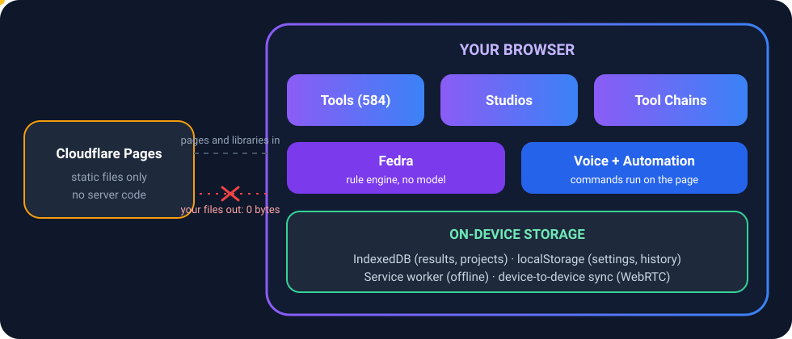

<!-- tc:header -->
<sub>[🏠 Toolcloak](../README.md) › [Docs](README.md) › **Architecture**</sub>
<!-- /tc:header -->

# Architecture

> A static site: files come in, yours never go out.



## The big idea
Toolcloak is a **static website**. Everything a visitor needs is a file served by Cloudflare Pages: HTML, JavaScript, CSS, fonts, WASM and the libraries each tool uses. After the page loads, the work happens in the visitor's browser.

```
next.config.js  ->  output: 'export'   (npm run build writes the whole site to out/)
```

There is **no `functions/` folder**, so no Workers or server code of ours runs. That is the foundation of the privacy story: there is nowhere for your file to be sent.

## Build pipeline
`npm run build` runs `prebuild` first:

| Step | Script | Produces |
|---|---|---|
| 1 | `copy-vendor.js` | Copies libraries from npm into `public/vendor/` so no outside CDN is needed |
| 2 | `generate-seo-pages.js` | Static SEO pages, `sitemap.xml`, `llms.txt`, `llms-full.txt`, `feed.xml`, Markdown copies of every article, `home-lite.js`, `categories-lite.js`, `tools-lite.js` |
| 3 | `generate-tool-components.js` | `src/lib/tool-components.js`, the map that lets tools load on demand |
| 4 | `generate-tool-io.js` | `src/lib/tool-io.js`, what every tool takes in and gives out (used by Chains) |
| 5 | `generate-assistant-index.js` | `public/assistant/index.json`, `knowledge.json`, `report.json` and `ASSISTANT-REPORT.md` |

Because these are regenerated on every build, **a new tool, guide or article is picked up automatically** in the sidebar, search, sitemap, SEO pages and Fedra.

## Runtime layers
1. **Pages and routes** (`src/app`): home, tools, categories, studios, articles, chains, My Space, settings, embeds and the info pages.
2. **Shared kits** (`src/components`): `ToolKit`, `LabKit`, `BizUi` and friends. A tool built with the kits gets History, Artifacts, Chains, Share link, Send to, Wishlist and search with no extra code.
3. **Engines** (`src/lib`): chain rules and runner, PDF operations, sheet engine, doc kit, data kit, geometry kit, mesh tools, voice agent, region engine, history and storage.
4. **Fedra** (`src/lib/assistant`): plain JavaScript modules, no React, tested in Node.
5. **On-device storage:** IndexedDB for results and projects, localStorage for settings and consent, a service worker for offline.

## Lazy loading
Only the header, footer and theme guard are in the main bundle. The cookie banner, analytics, PWA registration, region engine, swipe, shortcuts and the assistant load as separate chunks after the page is idle or on first touch. Tools load through `toolComponents` when needed.

## Data flow for a tool run
```
file picked  ->  tool runs in the browser  ->  result card
                                                  |-> Download
                                                  |-> Send to (another tool)
                                                  |-> Artifacts (IndexedDB, saved once)
                                                  |-> History (only with permission)
                                                  `-> Chain (reported through useChainEmit)
```
The file you pick is never stored. Only the result is.

## What does leave the browser
- Page, script and font requests to this site.
- Visit counting through Google Analytics 4 (advertising features off), and only after Accept for EU visitors.
- Requests to an address the visitor types, for the tools whose purpose is network access (API Request Builder, CORS Tester, DNS Lookup).
- Google's translate widget, only if the visitor turns translation on.
- Exchange-rate requests when the visitor's currency is not INR (see `src/lib/region.js`).

See [PRIVACY.md](PRIVACY.md).


<!-- tc:footer -->
<br/>

---

<div align="center">

<sub><a href="REGION_AND_TRANSLATE.md">← Region and Translate</a> &nbsp;·&nbsp; <a href="TECH_STACK.md">Tech Stack →</a></sub>
<br/><br/>
<a href="../README.md"><b>← Back to README</b></a> &nbsp;·&nbsp; <a href="README.md">Documentation index</a> &nbsp;·&nbsp; <a href="https://github.com/megawiper/toolcloak.com">megawiper/toolcloak.com</a>

<br/>

<a href="../README.md"></a>

<sub>Free tools, built to be genuinely useful. Your files stay yours.</sub>

</div>
