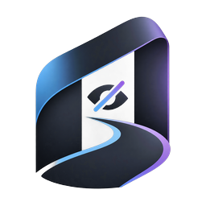

<!-- tc:header -->
[🏠 Toolcloak](../README.md) › [Docs](README.md) › **Branding**
<!-- /tc:header -->

# Branding

> Logos, colours and usage rules.

## 🖼️ Logos

| File | Use |
|---|---|
| `assets/brand/logo-wordmark.png` | The TCloak wordmark on light or dark backgrounds |
| `assets/brand/logo-wordmark-square.png` | Square version for avatars |
| `assets/brand/logo-icon.png` | The icon mark (512 px), also the source for favicons |
| `assets/brand/logo-icon-256.png` | Smaller icon |
| `assets/brand/favicon-64.png` | Favicon-size icon |

&nbsp;&nbsp;&nbsp;&nbsp;

## 🎨 Colours (sampled from the logo, approximate)

| Name | Hex |
|---|---|
| 🟣 Toolcloak Purple | `#7C3AED` |
| 🔵 Toolcloak Blue | `#0070E0` |
| ⚫ Night | `#0F172A` |

## ✅ Do

- Keep clear space around the logo equal to the height of the "T".
- Use the wordmark on plain backgrounds.

## ❌ Do not

- Stretch, recolour or add effects to the logo.
- Imply endorsement without permission.

<!-- tc:footer -->
 

---

<a href="ADVERTISE.md">← Advertise</a> &nbsp;·&nbsp; <a href="ROADMAP.md">Roadmap →</a>
  
<a href="../README.md"><b>← Back to README</b></a> &nbsp;·&nbsp; <a href="README.md">Documentation index</a> &nbsp;·&nbsp; <a href="https://github.com/megawiper/toolcloak.com">megawiper/toolcloak.com</a>

 

Free tools, built to be genuinely useful. Your files stay yours.

