# Toolcloak documentation

> Everything about how Toolcloak works, how to run it and how to add to it. Pick a card.

 

## 🧭 Product

| | Page | What you will find |
|:---:|---|---|
| ✨ | [**Features**](FEATURES.md) | Everything you can do on [toolcloak.com](https://toolcloak.com) |
| 🪜 | [**How a tool page works**](HOW_IT_WORKS.md) | One tool page, step by step |
| 🧰 | [**Tools**](TOOLS.md) | The catalogue: 567 tools in 17 categories |
| 🏗️ | [**Studios**](STUDIOS.md) | Full workspaces for bigger jobs |
| 🔗 | [**Tool Chains**](TOOL_CHAINS.md) | Link tools into one flow and run it in one tap |
| 🤖 | [**Fedra**](FEDRA.md) | The assistant with no AI server |
| 📚 | [**Guides**](GUIDES.md) | 188 long-form guides |
| 🏠 | [**My Space and Sync**](MY_SPACE_AND_SYNC.md) | Projects, files and direct device-to-device sync |
| 🎙️ | [**Voice and Automation**](VOICE_AND_AUTOMATION.md) | Drive the page by voice |
| 🧩 | [**Embed**](EMBED.md) | Put a tool on your own website |
| 📲 | [**PWA and Offline**](PWA_AND_OFFLINE.md) | Install it and keep working offline |
| 🌍 | [**Region and Translate**](REGION_AND_TRANSLATE.md) | Country, currency and translation |

## 🛠️ Engineering

| | Page | What you will find |
|:---:|---|---|
| 🏛️ | [**Architecture**](ARCHITECTURE.md) | A static site: files come in, yours never go out |
| 🧱 | [**Tech Stack**](TECH_STACK.md) | The framework, the libraries and why they are vendored |
| 🗂️ | [**Project Structure**](PROJECT_STRUCTURE.md) | Where everything lives |
| ➕ | [**Adding a Tool**](ADDING_A_TOOL.md) | Register it, add a route, build |
| ✍️ | [**Adding an Article**](ADDING_AN_ARTICLE.md) | Write a guide as one data file |
| 📜 | [**Scripts**](SCRIPTS.md) | npm scripts and build-time generators |
| 🧪 | [**Testing**](TESTING.md) | Node's built-in runner |
| 🚀 | [**Deployment**](DEPLOYMENT.md) | Cloudflare Pages |
| ⚡ | [**Performance**](PERFORMANCE.md) | Fast on a cheap phone |
| 🔎 | [**SEO**](SEO.md) | Sitemap, structured data, discovery |

## 🤝 Trust and community

| | Page | What you will find |
|:---:|---|---|
| 🔒 | [**Privacy**](PRIVACY.md) | What the code does today, in plain words |
| 🛡️ | [**Security Practices**](SECURITY_PRACTICES.md) | Defences and honest trade-offs |
| 🚨 | [**Security Policy**](../SECURITY.md) | How to report a vulnerability |
| ❓ | [**FAQ**](FAQ.md) | Quick answers |
| 💬 | [**Support**](SUPPORT.md) | Where to get help |
| 📣 | [**Advertise**](ADVERTISE.md) | Sponsor slots, donations and supporters |
| 🎨 | [**Branding**](BRANDING.md) | Logos, colours and usage rules |
| 🗺️ | [**Roadmap**](ROADMAP.md) | Now, next and later |
| 🎞️ | [**Media**](MEDIA.md) | The demo and every README asset |
| 🤲 | [**Contributing**](../CONTRIBUTING.md) | How to help |
| 📝 | [**Changelog**](../CHANGELOG.md) | What changed, newest first |
| 🕰️ | [**Development Log**](DEVELOPMENT_LOG.md) | The archived original README |
| 📕 | [**PDF Studio Changelog**](PDF_STUDIO_CHANGELOG.md) | Feature status for PDF Studio |

<!-- tc:footer -->
 

---

<a href="../README.md"><b>← Back to README</b></a> &nbsp;·&nbsp; <a href="https://github.com/megawiper/toolcloak.com">megawiper/toolcloak.com</a>

 

Free tools, built to be genuinely useful. Your files stay yours.

