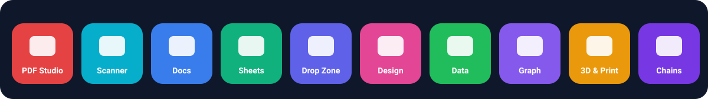

# Studios

Studios are full workspaces for bigger jobs. They run in your browser and save work to **My Space** as projects with thumbnails. See [MY_SPACE_AND_SYNC](MY_SPACE_AND_SYNC.md).

## PDF Studio `/studio/pdf`
- **Read:** virtual page rendering, zoom, fit, four view modes, rotation, fullscreen, print, **Present** mode, reading themes (Light, Sepia, Dark, Grey).
- **Side panel:** thumbnails (drawn only when visible), bookmarks, search (all pages, match case, whole word, accents, highlights, honest message for scans), document info.
- **Organise** every page as a picture: select, drag to reorder, rotate, delete, copy, add blank. Nothing changes until **Apply changes**, then it is one undo step.
- **Markup:** text (Hindi works), highlight, box, white-out, black cover, signature or picture. Move, resize and delete, then write all marks in one step.
- **Forms:** list text, checkbox, dropdown, list and radio fields. Fill, or fill and flatten.
- **Tools tab:** merge, split, stamps, convert.
- **Safety:** working copy with Undo and Redo (last 15 steps), unsaved-change protection, revert to last saved, name check on download, warning if the result is larger than the original.
- **Honest limits:** password-protected files open view-only; a black cover only hides what you see (use Shrink hard to remove content); a signature is a picture, not a legal digital signature; real redaction and a freehand pen are not built.
- Full history: [PDF_STUDIO_CHANGELOG](PDF_STUDIO_CHANGELOG.md).

## Document Scanner `/tools/document-scanner`
Camera or gallery. Drag the four corners to straighten. Filters: Original, Magic, B&W, Grey. Brightness and contrast, rotate, re-crop, page order, delete. Export as PDF (A4, Letter or Fit), JPG or ZIP, run OCR, or save to My Space.

## Docs `/office/docs`
Headings, fonts, size, colour, highlight, lists, alignment, links, images (shrunk), tables, lines, find and replace, web or A4 width, word count. Open TXT, MD or HTML. Export PDF (print), HTML, TXT or Markdown. All HTML is sanitised.

## Sheets `/office/sheets`
Formulas including SUM, AVERAGE, MIN, MAX, COUNT, IF, AND, OR, ROUND, SUMIF, COUNTIF, VLOOKUP, CONCAT, LEFT, RIGHT, LEN, UPPER, LOWER, TRIM, TODAY, NOW, SQRT, POWER, MOD and IFERROR. Circular references are flagged (`#CIRC!`). Virtual-scroll grid, formula bar, bold, italic, alignment, colours, borders, number formats, merge, sort, freeze first row, insert and delete. XLSX and CSV.

## Drop Zone `/drop`
Drop any file and see what you can do with it. Paste anywhere with Ctrl+V. Suggestions and "Open in studio" buttons come with icons.

## Design Studio `/studio/design`
Templates (Hindi quotes, YouTube thumbnail, card, poster, invitation, story), many sizes plus your own, text (8 fonts, Hindi), box, circle, line, photo, QR and stickers. Drag, four-corner resize, rotate handle (Shift for 15 degrees), snap to centre and edges, layers (order, hide, lock), duplicate, arrow keys, undo and redo, autosave. Export PNG or PDF. For background removal it links to the Background Remover tool.

## Data Studio `/studio/data`
CSV, JSON or Excel in. Clean the data, add formula columns, pick from 7 chart types, build a dashboard, export.

## Graph and Geometry `/studio/geometry`
`y=f(x)`, `x=c`, polar, parametric and implicit plots. Sliders (automatic, or write `a=3`). Zeros and crossings. Points, segments, circles and angles you can drag, with linked updates. Pinch and wheel zoom, PNG export, a share link that carries the formulas, and autosave.

## 3D Viewer and Print `/studio/3d`
Open STL (binary and ASCII) and OBJ. Orbit and zoom, shaded, wire and X-ray views, grid, two-point measure, size, volume and area, units (mm, cm, inch), scale, print estimate (material, infill, layer height, price), STL and OBJ conversion, PNG screenshot. The model itself is not saved (it can be large), only the settings.

## Tool Chains `/chains`
See [TOOL_CHAINS](TOOL_CHAINS.md).

## Not built yet
Scanner auto-corners, changing existing PDF text in place, pivot tables, slides, whiteboard, mind map, kanban, two-finger rotate in Design, GLB in the 3D viewer.
