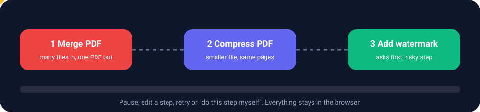

# Tool Chains

A chain links tools into one flow: the output of one step becomes the input of the next, all in your browser, with no re-uploading in between.

## Where things are
| Route | What |
|---|---|
| `/chains` | My chains, starter ideas you can remove, and a "How to build a chain" guide |
| `/chains/run` | The runner |
| `/chains/templates/<id>` | Ready-made chains |
| Chain button on every tool page | Add this tool to a chain, or start a new one (`/chains?new=<slug>`) |

## Building
- Every tool is tagged with what it **takes in** and **gives out** (`scripts/generate-tool-io.js` writes `src/lib/tool-io.js` before each build).
- **Fit check as you add.** In the builder every search result is marked *Fits* or *Cannot follow* for the last step. Picking one that cannot follow asks first and can add the missing converter for you (for example PDF to Word).
- **Settings per step.** A gear on every step in the builder and on the chain page. Chosen options appear as small chips.
- **Duplicate chain**, and **retry a failed step once automatically** (a switch on the chain page).
- New chains show a progress bar while they save and load each tool, then open at 100%.

## Running
- **Run and Pause** sit on the page under the last tool.
- **Pause**, **Pause after every step**, or **Pause before a step**. Open any step to see what went in and out, edit text or swap a file, change settings, then **Continue** from where it stopped.
- **Errors stop the chain at that step** with the reason. Choose Retry, Skip or Edit.
- **Do this step myself.** The real tool opens with the step's input and settings already in it. Its result, or a file you download from it, is caught and put into the chain with one tap. Later steps are cleared so Continue runs the rest.
- **Previews.** Pictures, the first page of a PDF, and audio and video players on each step and in the final result.
- Downloads are captured while a chain runs.

## Safety
Risky steps ask before they are added and again before the chain runs: watermark, page numbers, sign, delete or extract pages, crop, blur, metadata remover and encrypt. A second step of the same kind (two watermarks) gets a stronger warning.

## Templates
Video to MP3 then cut, PDF merge then compress, image to resize to WebP, photos to small PDF, compress photos then PDF then watermark, scan to clean text to PDF, PDF to clean text, trim video then compress, join audio then compress, video to small MP3, photos compress and ZIP, resize photo then compress.

## For tool authors
- Tools built with `ToolKit` and `LabKit` report results to the chain directly (`useChainEmit`).
- Hand-made tools mark run buttons with `data-chain-run` and report results with `useChainEmit`.
- Tools that cannot run in a chain are listed in `chainBlocked`. Fedra still finds and opens them.
- Chain rules live in `src/lib/chainRules.js` (`canFollow`, `checkChain`, `suggestBridge`, `riskNotes`, `joinsFiles`, `worksOnOneFile`).
