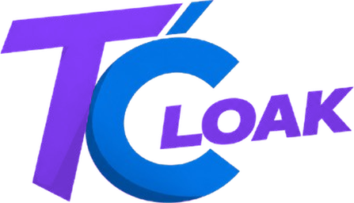

<!-- tc:header -->
[🏠 Toolcloak](../README.md) › [Docs](README.md) › **Voice and automation**
<!-- /tc:header -->

# Voice and automation

> Drive the page by voice, and re-run what you said.

## Voice
A round microphone button sits in the bottom corner (hide it with its small x, or in *Settings, Voice and automation*). There are also microphone buttons in the top bar and the menu. While Toolcloak listens, a soft blue, indigo and violet wave rises from the bottom and what it hears is written just above it.

### Things you can say
- "open merge PDF"
- "click Generate"
- "scroll down"
- "type hello"
- "add files"
- "open <project name>"
- "what can I click"

Commands work on whatever page you are on. The code is in `src/components/VoiceCommand.jsx` and `src/lib/voiceAgent.js`.

## Automation page (`/automation`)
A log of what you said and what Toolcloak did.

| Button | What it does |
|---|---|
| **Run again** | Goes back to the page where the command was spoken (for click, scroll and type) and does it again |
| **Test** | Same, but nothing is clicked or typed. The page highlights what it *would* touch, and the log records a test |
| **Check box** | Type a sentence and see how it is understood, without touching anything |

Everything is saved in this browser only. Nothing is uploaded.

## Permissions
The microphone is allowed for this site only (`Permissions-Policy: microphone=(self)`). Speech recognition depends on your browser.

<!-- tc:footer -->
 

---

<a href="MY_SPACE_AND_SYNC.md">← My Space and Sync</a> &nbsp;·&nbsp; <a href="EMBED.md">Embed →</a>
  
<a href="../README.md"><b>← Back to README</b></a> &nbsp;·&nbsp; <a href="README.md">Documentation index</a> &nbsp;·&nbsp; <a href="https://github.com/megawiper/toolcloak.com">megawiper/toolcloak.com</a>

 

Free tools, built to be genuinely useful. Your files stay yours.

